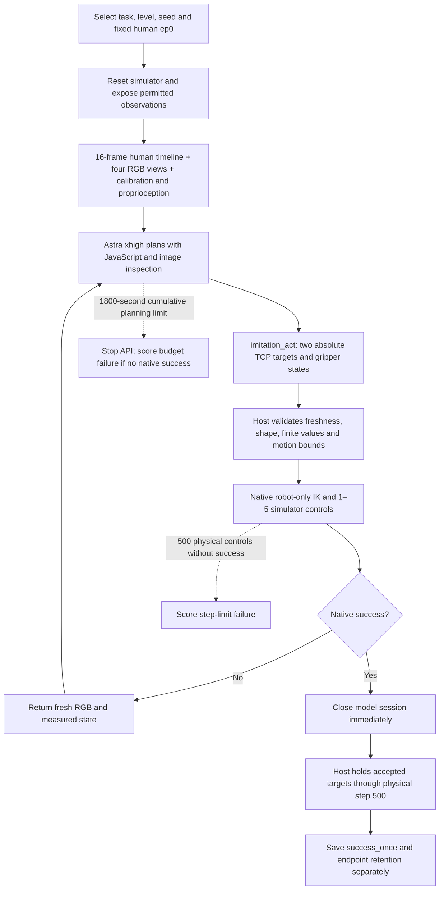

# GPT workflow

## Tools and state

- `imitation_start`: called once; returns the human timeline, cameras, calibration, TCP/base/joint state, and robot-only URDF reference.
- `imitation_act`: executes one validated absolute dual-arm target for 1–5 controls. Stale observation IDs or invalid commands execute no physics.
- `imitation_reference_frame`: inspects another timestamp from this episode's fixed human demonstration without advancing the simulator.
- `imitation_inspect`: inspects already provided observation/reference images or the robot-only URDF. Evaluator truth and unrelated paths are rejected.

The Codex app-server exposes these through code-mode. Image-bearing tool results must be forwarded with `image(...)`; printing the JSON alone does not display them. The policy must inspect the fresh observations between actions. There is no learned low-level policy, object-aware motion planner, grasp macro, simulator reset or agent delegation in this workflow.

## Two clocks

The planning clock includes client-observed API queueing, network waits, retries, inference, compaction and in-memory agent planning. It excludes initialization, host tool execution, simulation/rendering, post-success holding and artifact finalization. It is not a measurement of pure server inference.

The physical clock advances only through simulator controls, up to 500. A native success may interrupt a 1–5-control action chunk. The model is closed before the remaining held controls run. Native success takes priority over later bookkeeping or a budget-boundary race.

## Batch lifecycle

The recorded coordinator admits at most five workers and records each attempt before spawning it. A first-20-case engineering/cost gate checks infrastructure and spend; its success rate does not determine whether the rest are evaluated. Completed selected cases are immutable and skipped on resume. Ordinary task failures and planning timeouts are terminal, not automatically retried. Infrastructure recovery is limited to certified pre-model startup failures with a new attempt ID.

The original 88 timeouts were later eligible for a separate 30+30-minute continuation from restored state and conversation history. That work changed concurrency to four and was incomplete at 52/88, with 23 additional successes. It is not pooled into the primary 30-minute CSV/JSON.
